Aerodynamics
============

The **Aerodynamics** section defines the functions that produce aerodynamic
forces and moments. The screenshots show the C172P model. Other vehicles can
have different functions, names, inputs, and tables; the editor displays the
functions stored in the selected vehicle.

How the editor reads a function
-------------------------------

Each function has a **name**, an **axis**, and a formula. The name is the
property other formulas can read. Names are case-sensitive and must be unique:
``aero/coefficient/CL`` and ``aero/coefficient/Cl`` are different properties.
The axis tells JSBSim where to add the formula's result. **LIFT**, **DRAG**,
and **SIDE** are forces; **ROLL**, **PITCH**, and **YAW** are moments.
**(section)** publishes a reusable value without adding it directly to an
axis. The pictured model uses the wind-axis force names. For a vehicle using
body axes, the picker offers **AXIAL**, **NORMAL**, **X**, **Y**, and **Z**
instead; the two force-axis families are kept separate.

The selector beneath the name chooses what the formula does. **Multiply**
multiplies its operands; **add** sums them. An operand can read **a property**,
use **a number**, or look up **a table**. Operators can contain other operators.
The number has no fixed unit of its own: its meaning depends on the factors
beside it. A property operand reads its current value from the simulator.
The **+ operand** button adds another input to the selected operator; the red
cross removes that input or the whole function. **+ coefficient** adds a new
function, initially under **LIFT**. **+ declaration** creates a named vehicle
property with an optional starting value for formulas to read. Removing a
declaration that a formula still reads can prevent the model from loading.

In the C172P functions, ``aero/qbar-psf`` is dynamic pressure in pounds per
square foot and ``metrics/Sw-sqft`` is reference wing area in square feet.
Their product converts a dimensionless force factor into pounds of force.
Multiplying again by ``metrics/bw-ft`` (wing span) or
``metrics/cbarw-ft`` (mean chord) gives a moment in pound-feet. A name under
``aero/coefficient/`` does not make the function's final output dimensionless:
the complete formula and its axis determine the result.

For a **lookup table**, **looked up in** selects the input property. In a
curve, **in** holds input values and **out** holds the corresponding result;
the graph shows the same pairs. Values between rows are interpolated and
values beyond the first or last row use that end row. **+ Add row** extends
the curve. A grid has a row input and a column input; its column headings
select the second property, and each cell is the result for that pair. The
following functions show both forms. In these formulas, ``aero/alpha-rad``
is angle of attack, ``aero/beta-rad`` is sideslip angle, and the
``fcs/*-pos`` properties are control-surface positions. The ``p``, ``q``,
and ``r`` aerodynamic rates correspond to roll, pitch, and yaw.

Reusable functions
------------------

``aero/function/kCDge`` and ``aero/function/kCLge`` are ground-effect
multipliers. Both look up ``aero/h_b-mac-ft``, the height of the mean
aerodynamic chord above the ground in feet. ``kCDge`` scales selected drag
terms; ``kCLge`` scales selected lift terms. Their tables approach 1 as
height increases, so those terms return to their ordinary values away from
the ground.

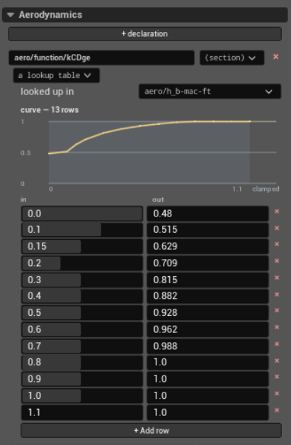

``aero/function/velocity-induced-fps`` adds the forward aerodynamic velocity
to two reads of ``propulsion/engine/prop-induced-velocity_fps`` in this
aircraft's formula. ``aero/function/qbar-induced-psf`` squares that result
and multiplies it by air density and 0.5. The elevator pitch and rudder yaw
functions below use this induced-flow pressure instead of
``aero/qbar-psf``.

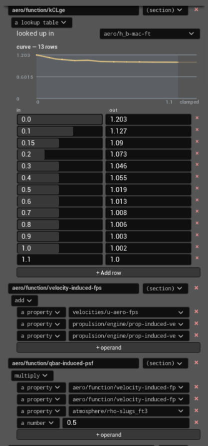

Drag
----

The **DRAG** functions are added to the aerodynamic drag axis. In this model
each one supplies a separate force contribution:

* ``CDo`` multiplies dynamic pressure and wing area by 0.027. It is the drag
  contribution at zero lift.
* ``CDDf`` adds drag from flap deflection. Its curve reads
  ``fcs/flap-pos-deg``; its result is multiplied by dynamic pressure, wing
  area, and ``kCDge``.

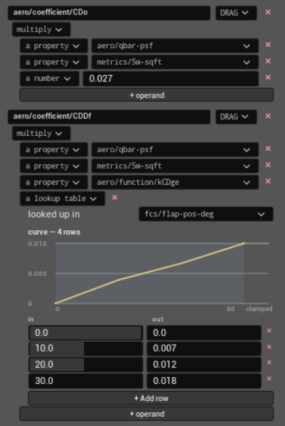

* ``CDwbh`` describes drag as angle of attack changes. The grid reads
  ``aero/alpha-rad`` by row and ``fcs/flap-pos-deg`` by column. Its result is
  multiplied by dynamic pressure, wing area, and ``kCDge``. Each flap column
  has its own angle-of-attack curve.

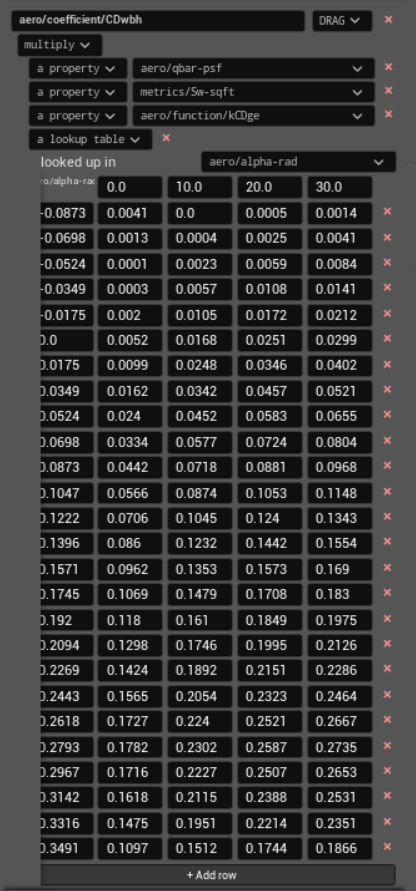

* ``CDDe`` adds drag proportional to the magnitude of elevator deflection,
  ``fcs/mag-elevator-pos-rad``. Both deflection directions add drag.
* ``CDbeta`` adds drag proportional to the magnitude of sideslip,
  ``aero/mag-beta-rad``. Its factor is 0.17 in this model.

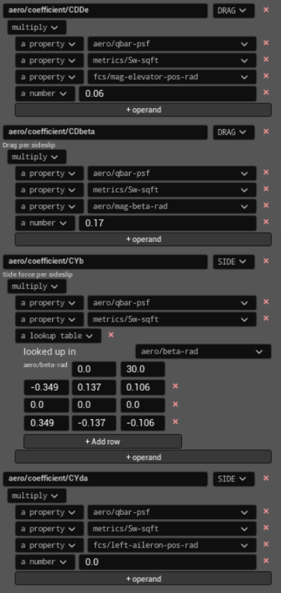

Side force
----------

The **SIDE** functions produce force along the lateral aerodynamic axis:

* ``CYb`` reads sideslip angle, ``aero/beta-rad``, and flap position from a
  grid. It gives the side force caused by sideslip at each flap setting.
* ``CYda`` multiplies left-aileron deflection by a fixed factor. That factor
  is zero in the pictured model, so this term contributes no side force.
* ``CYdr`` adds side force from rudder deflection. The input is
  ``fcs/rudder-pos-rad`` and the factor is 0.187.
* ``CYp`` adds side force from aerodynamic roll rate,
  ``velocities/p-aero-rad_sec``. ``aero/bi2vel`` scales the rate by half the
  wing span divided by airspeed; a grid changes the factor with angle of
  attack and flap position.
* ``CYr`` follows the same structure for aerodynamic yaw rate,
  ``velocities/r-aero-rad_sec``, with its own grid of factors.

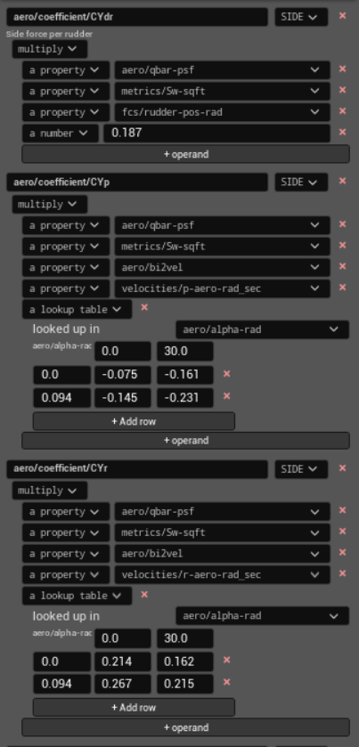

Lift
----

The **LIFT** functions add forces along the lift axis. The C172P also has
``CLwbh`` above the portion shown in these screenshots: its grid reads angle
of attack and stall-hysteresis state, then ``kCLge`` scales the result.

* ``CLDf`` adds lift from flap deflection. Its flap-angle curve is multiplied
  by dynamic pressure, wing area, and ``kCLge``.
* ``CLDe`` adds lift proportional to elevator deflection in radians. Its
  factor is 0.43.
* ``CLadot`` adds lift from the rate of change of angle of attack,
  ``aero/alphadot-rad_sec``. ``aero/ci2vel`` scales that rate by half the
  mean chord divided by airspeed.

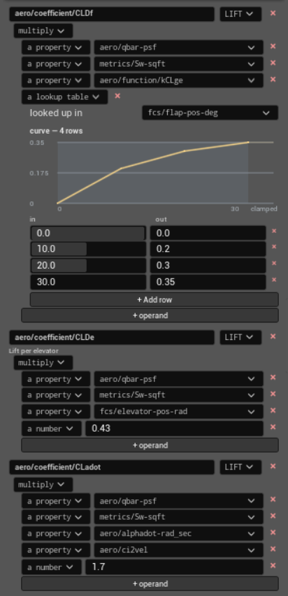

* ``CLq`` adds lift from aerodynamic pitch rate,
  ``velocities/q-aero-rad_sec``, scaled by ``aero/ci2vel``. Its factor is
  3.9 in this model.

Roll moment
-----------

The **ROLL** functions multiply dynamic pressure and wing area by wing span
and their remaining factors. Their results are moments about the roll axis:

* ``Clb`` reads sideslip angle from a curve. The sign of the returned value
  changes across zero sideslip; this is the model's dihedral effect.
* ``Clp`` is roll damping. It uses aerodynamic roll rate and
  ``aero/bi2vel`` with a negative factor, opposing roll in this model.

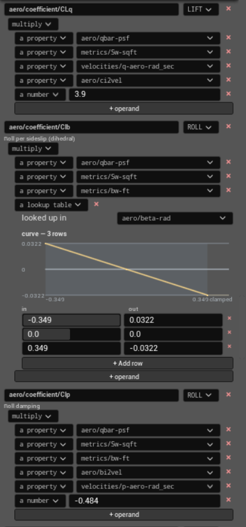

* ``Clr`` is roll moment from yaw rate. Its factor comes from a grid indexed
  by angle of attack and flap position.
* ``ClDa`` is roll moment from left-aileron deflection.
* ``Cldr`` is roll moment from rudder deflection.

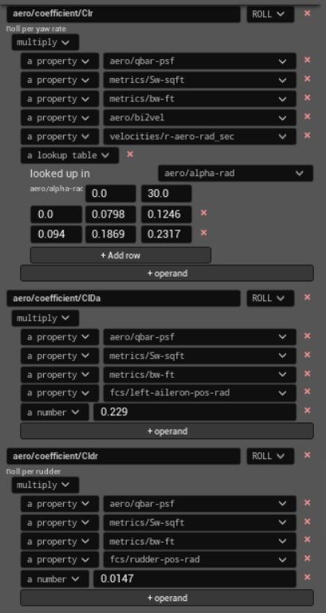

Pitch moment
------------

The **PITCH** functions use mean chord as their moment arm:

* ``Cmo`` supplies a baseline pitch moment at zero angle of attack.
* ``Cmalpha`` changes pitch moment with angle of attack. Its negative factor
  supplies a restoring pitch tendency for positive angle of attack in this
  model.
* ``Cmq`` is pitch damping from aerodynamic pitch rate. It uses
  ``aero/ci2vel`` and a negative factor.
* ``Cmadot`` changes pitch moment with the rate of change of angle of attack.
  It also uses ``aero/ci2vel``.

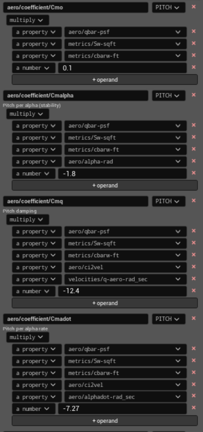

* ``Cmde`` changes pitch moment with elevator deflection. This function uses
  ``aero/function/qbar-induced-psf``, so its pressure input includes the
  propeller-induced flow defined above.
* ``Cmdf`` changes pitch moment with flap position. Its curve returns a
  different factor for each flap angle.

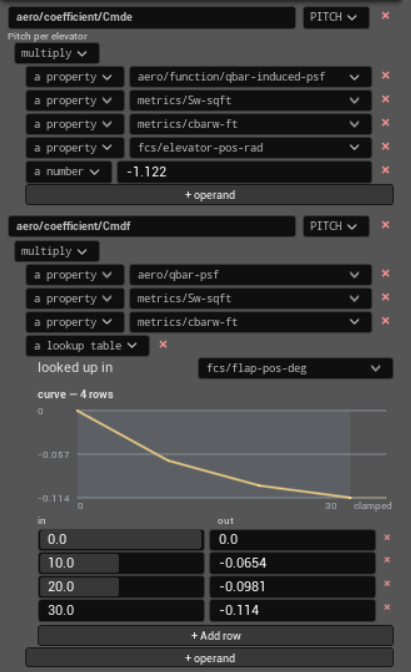

Yaw moment
----------

The **YAW** functions use wing span as their moment arm:

* ``Cnb`` reads a curve of sideslip angle. It gives the weathercock yaw
  tendency as sideslip changes.
* ``Cnp`` changes yaw moment with aerodynamic roll rate, scaled by
  ``aero/bi2vel``.

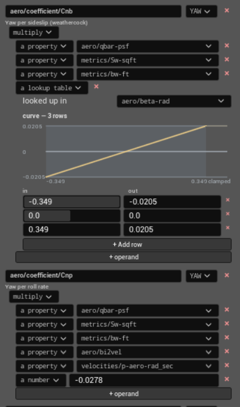

* ``Cnr`` is yaw damping from aerodynamic yaw rate, also scaled by
  ``aero/bi2vel``.
* ``Cnda`` changes yaw moment with left-aileron deflection. Its negative
  factor produces the adverse-yaw contribution in this model.
* ``Cndr`` changes yaw moment with rudder deflection. Like ``Cmde``, it uses
  ``aero/function/qbar-induced-psf`` to include propeller-induced flow.

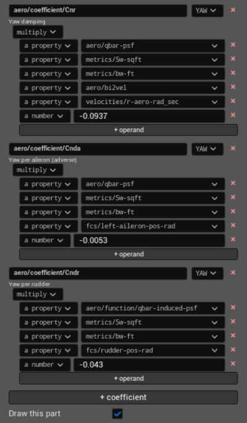
