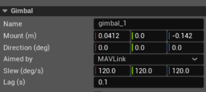
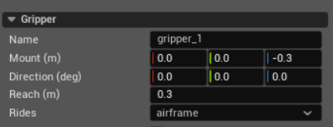

Aircraft Stores
===============

Aircraft Stores covers equipment carried outside the flight-dynamics model:
gimbals that aim cameras or sensors, and the gripper that carries a payload.
Both are stored in ``Visual.xml`` and use its vehicle frame: X forward, Y
right, and Z up. A component attached to a gimbal uses the selected gimbal
stage as its parent frame.

Gimbal
------

A gimbal is an invisible three-axis mount. Its mount has a fixed pose on the
vehicle; its head turns from that pose in yaw, roll, then pitch. A fixture or
gripper can ride the head or an individual gimbal stage. Another gimbal and a
sensor that provides a **Rides** setting can ride the head only. A propeller
cannot ride a gimbal. A vehicle may contain more than one gimbal.

**Name**
   The unique name shown in the aircraft tree and written to ``Visual.xml``.
   Other components use this name in their **Rides** or parent setting.
   Renaming the gimbal updates those references. The name cannot be empty or
   duplicate the name of another visual part, gimbal, or gripper. It cannot
   contain a period because a period separates a gimbal name from a stage
   name, as in ``gimbal_1.yaw``.

**Mount (m)**
   Position of the fixed mount as X, Y, and Z in metres. When the gimbal rides
   the airframe, the position is measured from the vehicle centre of mass.
   When it rides another gimbal, it is measured from that gimbal's moving
   head.

**Direction (deg)**
   Resting orientation of the mount as roll, pitch, and yaw in degrees. Aim
   commands are offsets from this orientation; they do not replace it.

**Aimed by**
   Selects which source owns the target angles:

   * **MAVLink** uses the gimbal roll, pitch, and yaw bindings configured under
     **Inputs**. Each received actuator frame rewrites all three target axes;
     an unbound axis is held at zero. These bindings work only when the vehicle
     has exactly one gimbal. With two or more gimbals, PteroSim cannot decide
     which mount they address and disables the gimbal bindings.
   * **API** lets scripts set the target angles. Incoming actuator frames leave
     this gimbal unchanged.

   The selected source is saved with the vehicle. A script can take or return
   control temporarily without changing the saved value.

**Slew (deg/s)**
   Maximum roll, pitch, and yaw speed in degrees per simulated second. Each
   axis is limited separately. Zero removes the speed limit for that axis, so
   it moves as quickly as **Lag** permits. Negative values are rejected.

   These values describe the simulated servos. Autopilot gimbal-rate settings
   do not replace them.

**Lag (s)**
   First-order time constant applied while the head approaches its target.
   A larger value produces a slower, smoother response. Zero reaches the
   target within the current simulation step, subject to **Slew**. Negative
   values are rejected. PteroSim applies lag first and then the slew limit.

**Rides**
   Appears when another gimbal is available. **airframe** attaches this mount
   to the vehicle; selecting another gimbal attaches it to that gimbal's head.
   A gimbal cannot ride itself or form a circular chain. Changing **Rides**
   keeps the numeric **Mount** and **Direction** values and reinterprets them
   in the new parent frame.

Stopping the simulation returns the target and current gimbal angles to zero,
which places the head back at **Direction**.

Gripper
-------

The gripper opens and closes around payload actors. Closing it takes the
nearest detached payload within **Reach**; opening it releases the held
payload. While held, the payload keeps the pose it had relative to the gripper
when taken. Its mass and centre of mass are represented in JSBSim by a point
mass. The editor permits one gripper per vehicle because the gripper input
binding does not identify a specific gripper.

**Name**
   The unique name shown in the aircraft tree and written to ``Visual.xml``.
   The name cannot be empty or duplicate another visual-part name. Other
   components cannot ride a gripper, so renaming it does not update parent
   references.

**Mount (m)**
   Centre of the **Reach** sphere, as X, Y, and Z in metres. On the airframe it
   is measured from the vehicle centre of mass. When the gripper rides a
   gimbal or one of its stages, it is measured in that parent frame. A payload
   is not moved to this point when taken; it keeps its current pose relative
   to the gripper.

   When the FDM loads, PteroSim creates a zero-mass JSBSim point mass at the
   gripper's fitted vehicle position. Closing on a payload changes that point
   mass to the payload's mass and moves it to the payload's centre of mass.
   Releasing the payload returns the point mass to zero mass.

**Direction (deg)**
   Stored roll, pitch, and yaw values. They currently do not affect the
   gripper: **Reach** is a sphere, and a held payload keeps the pose it had
   relative to the gripper when taken.

**Reach (m)**
   Radius around **Mount** searched when the open gripper closes. PteroSim
   selects the nearest detached payload whose physics body overlaps this
   sphere. A gripper that closes empty stays closed and does not take a payload
   that enters the sphere later; it must open and close again. Reach must be
   greater than zero.

**Rides**
   Appears when the vehicle has a gimbal. **airframe** attaches the gripper to
   the vehicle. Other choices attach it to a gimbal's head or an individual
   yaw or roll stage. Changing the parent keeps the numeric **Mount** and
   **Direction** values and reinterprets them in the new parent frame.

Control the gripper through a **Gripper** binding under **Inputs**. It reads
the raw actuator-frame value: above ``0.5`` closes the jaw, below ``-0.5``
opens it, and values between the thresholds keep the current state. Only the
first Gripper binding is used, and commands act only while the simulation is
running. Configure the incoming channel so it can produce both positive and
negative commands.

Closing takes a payload only during the transition from open to closed.
Opening releases it. Stopping the simulation also opens the gripper, releases
any payload, and removes its mass from the aircraft.
