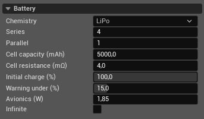

Battery
=======

The Battery section configures the electrical pack that supplies brushless
motors. PteroSim calculates its charge, current, and terminal voltage during
the simulation. A vehicle can have one battery pack. Add it with **+ Add** →
**Battery** in the vehicle tree; a new pack starts with the values shown below.

**Chemistry**
   Selects the cell voltage curve. Each chemistry defines a cell's resting
   voltage at different charge levels; PteroSim interpolates between its
   points. The choices include chemistry files in the vehicle's ``Batteries``
   folder and templates in the PteroSim catalogue. Selecting a catalogue
   chemistry copies its file into the vehicle before using it. Chemistry
   changes the voltage as charge falls; it does not set capacity or resistance.

**Series**
   Number of cells connected in series. PteroSim multiplies the chemistry's
   cell voltage by this number to obtain the pack's resting voltage. Series
   cells also add their internal resistances, increasing voltage drop under
   load. This value is a whole number of at least one.

**Parallel**
   Number of cell strings connected in parallel. Each string adds the capacity
   entered under **Cell capacity**. Parallel strings reduce the pack's
   effective internal resistance because they share the load. This value is a
   whole number of at least one.

**Cell capacity (mAh)**
   Capacity of one cell, not the entire pack. Pack capacity is this value
   multiplied by **Parallel**; connecting cells in series does not increase
   it. Motor and avionics current reduce the remaining charge according to
   this capacity. The value must be greater than zero.

**Cell resistance (mΩ)**
   Internal resistance of one cell. Pack resistance is this value multiplied
   by **Series** and divided by **Parallel**. PteroSim subtracts current times
   pack resistance from the resting pack voltage, so greater resistance causes
   greater voltage sag under load. Zero models no internal voltage drop.

**Initial charge (%)**
   Charge level at the start of each run, from 0 to 100%. It determines the
   initial resting voltage from the chemistry curve and how much capacity
   remains. Restarting the simulation restores this charge level. Zero charge
   is not a motor cutoff: the voltage still follows the chemistry curve at
   0%.

**Warning under (%)**
   Low-battery threshold, from 0 to 100%. The manual-flight HUD shows a
   **LOW BATTERY** warning when the displayed charge, rounded to a whole
   percent, drops below this value. The threshold is also included in battery
   status available to scripts. It does not stop the motors or reserve charge.

**Avionics (W)**
   Constant electrical power drawn in addition to the motors. PteroSim
   converts it to battery current using the preceding step's voltage and
   includes that current in charge depletion and voltage sag. When voltage
   is zero, the model adds no avionics current. Zero disables this load.

**Infinite**
   Keeps the pack at its **Initial charge** throughout the run. Motors and
   avionics still draw current, so the voltage still sags under load, but
   charge does not fall. This does not bypass the initial charge setting.

The battery configuration does not specify mass or position. Account for the
physical pack in **Mass Balance** so its weight affects the flight model.
