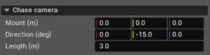

Chase Camera
============

Chase camera is the third-person view that follows the vehicle. It is the
initial view when the vehicle is selected and is included in the vehicle's
camera cycle. It does not capture or stream images.

**Mount (m)**
   Point that the camera follows, in metres from the vehicle centre of mass.
   The axes are X forward, Y right, and Z up.

**Direction (deg)**
   View direction as roll, pitch, and yaw in degrees. Pitch moves the view
   above or below the vehicle, yaw moves it around the vehicle, and roll tilts
   the horizon.

**Length (m)**
   Distance between the camera and **Mount**, in metres. It must be greater
   than zero.
