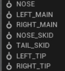

Gear
====

Gear defines the points where the aircraft touches the ground. Each contact has
its own position, suspension, and friction. Wheel contacts can also steer,
brake, retract, or caster.

An aircraft can have many separate Gear components. A tricycle aircraft
normally has independent nose, left-main, and right-main contacts; additional
contacts can represent skids, a tail bumper, or wingtip protection.

The fields below use the **NOSE** contact as an example.

.. image:: ../Images/editor_gear_nose.png
   :alt: Nose-wheel Gear component in the vehicle editor
   :class: no-float-left

Contact
-------

**Name**
   A descriptive name shown in the component list and logs. It does not control
   steering or braking. The example contact is named ``NOSE``.

**Type**
   Selects how JSBSim treats the contact:

   * **Bogey** represents a wheel. It provides the wheel-specific fields for
     orientation, rolling friction, steering, brakes, retraction, and
     castering.
   * **Structure** represents a non-rolling contact such as a skid or protective
     point. It still uses the location, friction, spring, and damping fields,
     but hides the wheel-specific fields.

**Location (m)**
   The contact point in the structural frame. The three boxes are X, Y, and Z:
   X points aft, Y right, and Z up. The example nose wheel is 0.17272 m ahead
   of the structural origin, on the centreline, and 0.4953 m below it.

Ground interaction
------------------

These fields apply to both **Bogey** and **Structure** contacts.

**Static friction**
   The dimensionless friction coefficient while the contact is not sliding.
   It determines how much horizontal force the ground can apply before the
   contact begins to slip.

**Dynamic friction**
   The dimensionless friction coefficient used while the contact is sliding
   across the ground. It is usually lower than static friction.

**Spring (N/m)**
   The strut stiffness. JSBSim multiplies it by contact compression to produce
   the normal spring force. A larger value gives a stiffer contact; the value
   must be greater than zero.

**Damping (N/m/s)**
   The damping applied while the strut compresses. It resists compression
   speed and reduces bouncing after touchdown. The value must be greater than
   zero.

**Damping, rebound (N/m/s)**
   The damping applied while the strut extends again. A value of zero tells
   JSBSim to use the compression damping value for rebound as well.

Wheel fields
------------

The following fields appear only when **Type** is **Bogey**.

**Orientation (deg)**
   The strut-axis orientation as roll, pitch, and yaw in the aircraft model's
   coordinates. These are JSBSim angles, not an Unreal Engine rotation. The
   three zeroes in the example use the default orientation.

**Rolling friction**
   The dimensionless resistance while the wheel rolls. This is separate from
   sliding friction and is normally much smaller; the example uses ``0.02``.

**Max steer (deg)**
   The maximum steering angle commanded for this wheel. Zero makes it
   non-steerable. The example nose wheel can steer up to 10 degrees.

**Brake group**
   Selects which brake command acts on this wheel. **None** leaves the contact
   unbraked. Left and right main wheels are normally assigned to their
   corresponding brake groups; the example nose wheel uses **None**.

**Retractable**
   Makes the contact follow the landing-gear up/down command. Leave it cleared
   for fixed landing gear.

**Castered**
   Makes the wheel swivel freely like a trolley wheel and ignore steering
   commands. Leave it cleared for a nose wheel controlled by **Max steer**.

The × in a contact header removes that Gear component when the aircraft has
another contact. PteroSim keeps at least one contact in the model.
