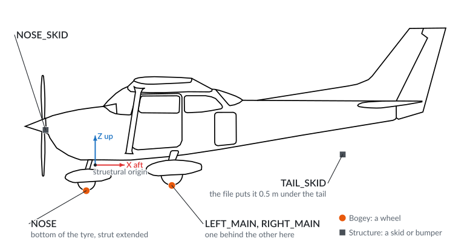
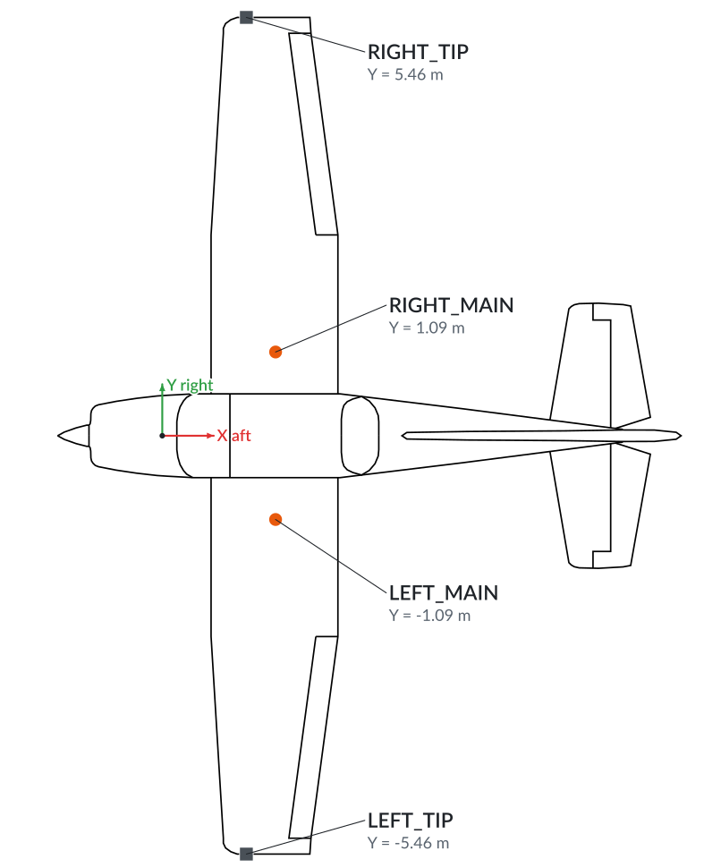
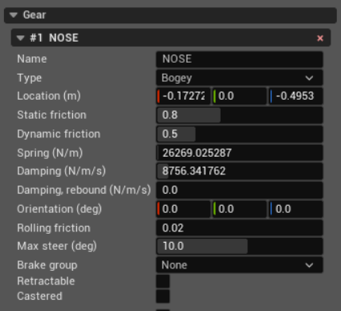

Gear
====

Gear defines the points where the aircraft touches the ground. Each contact has
its own position, suspension, and friction. Wheel contacts can also steer,
brake, retract, or caster.

Each contact is a separate Gear component. A tricycle aircraft normally has
nose, left-main, and right-main wheels; additional contacts can represent
skids, a tail bumper, or wingtip protection. The c172p has seven. From the
side, its wheels touch at the bottom of their tyres, and skids guard the nose
and tail:

From above, the main wheels and the wingtip contacts come in pairs: the left
one has negative Y, the right one positive Y.

**+ Add** → **Gear contact** in the aircraft tree adds a **Bogey** contact
named ``Contact_1`` (the first free number) at the structural origin. Set its
**Location** before you apply.

The fields below use the **NOSE** contact as an example.

Contact
-------

**Name**
   A descriptive name shown in the aircraft tree, the contact header, and
   logs. It does not control steering or braking. The example contact is
   named ``NOSE``.

**Type**
   Selects how JSBSim treats the contact:

   * **Bogey** represents a wheel. It provides the wheel-specific fields for
     orientation, rolling friction, steering, brakes, retraction, and
     castering.
   * **Structure** represents a contact that does not roll, such as a skid or
     bumper. It still uses the location, friction, spring, and damping
     fields, but hides the wheel-specific fields.

**Location (m)**
   The point that touches the ground while the strut is fully extended: for a
   wheel, the bottom of the tyre. It is in the structural frame, and the three
   boxes are X, Y, and Z: X points aft, Y right, and Z up. The example nose
   wheel is 0.17272 m ahead of the structural origin, on the centreline, and
   0.4953 m below it.

Ground interaction
------------------

These fields apply to both **Bogey** and **Structure** contacts, except where
noted.

**Static friction**
   The friction coefficient that limits how much horizontal force the ground
   can apply. A **Structure** contact uses it while it is not sliding. For a
   wheel, it is the tyre's peak sideways grip and its grip along the rolling
   direction under full brake.

**Dynamic friction**
   The friction coefficient of a **Structure** contact that is sliding. It is
   usually lower than static friction. Wheels do not use it.

**Spring (N/m)**
   The strut stiffness. JSBSim multiplies it by the strut compression to get
   the spring force. A larger value gives a stiffer contact; the value must be
   greater than zero.

**Damping (N/m/s)**
   The damping applied while the strut compresses. It resists compression
   speed and reduces bouncing after touchdown. The value must be greater than
   zero.

**Damping, rebound (N/m/s)**
   The damping applied while the strut extends again. Zero leaves it out of
   ``Gear.xml``, and JSBSim then uses the compression damping for the rebound
   as well.

Wheel fields
------------

The following fields appear only when **Type** is **Bogey**.

**Orientation (deg)**
   The orientation of the strut as roll, pitch, and yaw. JSBSim measures the
   wheel's compression along the strut, and yaw turns the direction the wheel
   rolls. All zeros, as in the example, keep the strut along the structural Z
   axis and roll the wheel along X. These are JSBSim angles, not an Unreal
   Engine rotation.

**Rolling friction**
   The friction coefficient along the rolling direction while the brakes are
   off. It is normally much smaller than static friction; the example uses
   ``0.02``.

**Max steer (deg)**
   The wheel's angle at full steering command. Zero makes it non-steerable,
   and a negative value steers it the other way, as on a tail wheel. The
   example nose wheel steers up to 10 degrees.

**Brake group**
   Selects the brake command that acts on this wheel: **Left**, **Right**, or
   **Center**. JSBSim treats **Nose** and **Tail** as **Center**, and **None**
   leaves the wheel unbraked. Braking raises the friction along the rolling
   direction from **Rolling friction** to **Static friction** at full brake.
   Main wheels normally use **Left** and **Right**; the example nose wheel
   uses **None**.

**Retractable**
   Makes the contact follow the landing-gear up/down command. While the gear
   is not fully down, the contact produces no force. Leave it cleared for
   fixed landing gear.

**Castered**
   Makes the wheel swivel freely like a trolley wheel and ignore steering
   commands. Leave it cleared for a nose wheel controlled by **Max steer**.

The × in a contact header removes that contact. PteroSim keeps at least one
contact in the model, so the last one cannot be removed.

The aircraft drawing is the Cessna 172 three-view by Marek Cel, CC0, from
Wikimedia Commons.
