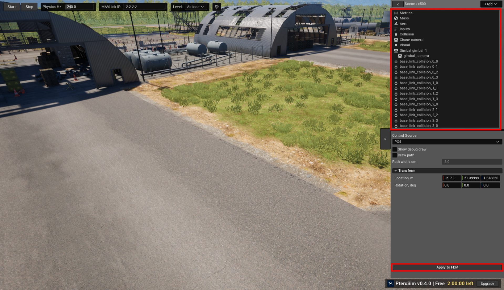

Build Your Own Vehicle
======================

In a release build, each vehicle is stored under
``PteroSim/PteroSimAircrafts/<Name>`` relative to the release directory. The
vehicle directory and its JSBSim manifest must have the same name, so the full
relative path is ``PteroSim/PteroSimAircrafts/<Name>/<Name>.xml``.

Open the vehicle editor
-----------------------

With the simulation stopped, select a vehicle in **Scene**. Its components
appear in the aircraft tree. Select a component to open its editor section.

**Apply to FDM** writes the changes and reloads the flight-dynamics model. If
validation fails, PteroSim reports the problem and does not reload the model.

Coordinate systems
------------------

The **Metrics**, **Mass Balance**, **Gear**, **Propulsion**, **Tanks**,
**External Forces**, and **Buoyancy** sections use the JSBSim structural frame:
metres, with X aft, Y right, and Z up.

``Visual.xml`` and ``Sensors.xml`` use a separate vehicle frame: metres, with X
forward, Y right, and Z up. Orientations in these files are roll, pitch, and yaw
in degrees. A component attached to a gimbal or nacelle uses its parent's frame.

See `Frames of Reference in the JSBSim manual
<https://jsbsim-team.github.io/jsbsim-reference-manual/user/concepts/frames-of-reference/>`_
for the JSBSim coordinate systems.

Components
----------

.. toctree::
   :maxdepth: 1

   metrics
   mass_balance
   aerodynamics
   gear
   propulsion
   tanks
   battery
   external_forces
   buoyancy
   inputs
   logic_graphs
   parts
   chase_camera
   aircraft_stores
   collision
   sensors
