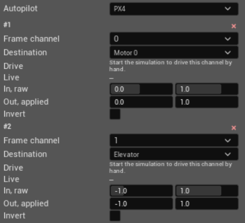

Inputs
======

Inputs maps channels from an autopilot actuator frame to motors, control
surfaces, gimbals, grippers, and other writable vehicle properties. A vehicle
can have many bindings. Every numbered binding uses the same fields, and one
frame channel can be assigned to several destinations when one signal must
drive several parts.

Autopilot
---------

**Autopilot**
   Selects the flight stack whose actuator frame these bindings describe.
   Available choices come from the autopilots installed in PteroSim. Select
   **(none)** for a vehicle that does not receive an autopilot actuator frame.
   The selector is disabled while the simulation is running.

   Different autopilots may put the same control on different channels.
   PteroSim stores bindings for each selected flight stack separately and
   keeps the bindings for the other stacks when the selection changes.

Bindings
--------

**Frame channel**
   The zero-based position of the value in the incoming actuator frame, from
   0 to 15. The numbering and meaning of the channels are defined by the
   selected autopilot. Several bindings may read the same channel; this fans
   one command out to several destinations.

**Destination**
   The vehicle input that receives the mapped value. The list includes each
   motor, externally driven inputs from the vehicle's logic graphs, an
   installed gripper, the axes of a single installed gimbal, and writable
   properties published by the loaded flight model. The list is searchable,
   and a property path can also be entered directly.

   Changing the destination resets both ranges to suitable defaults. Motors,
   flaps, and grippers use 0 to 1. Bidirectional controls use -1 to 1. Gimbal
   axes use an input range of -1 to 1 and an output range of -90 to 90
   degrees. Adjust the ranges afterwards if the destination expects something
   else.

   PteroSim checks entered property paths when the changes are applied. It
   refuses a path that the loaded model does not publish as a writable
   property and suggests a similarly named property when possible.

**Drive**
   Sends a raw channel value by hand for checking the binding. It is available
   only while the simulation is running and the active control source is not
   **Manual**. The slider covers the **In, raw** range.

   Moving the slider sends a complete 16-channel test frame. Channels not set
   by a **Drive** slider are sent as zero. The test frame does not take
   permanent control from the autopilot: whichever frame arrives last is the
   one PteroSim applies.

**Live**
   Shows the latest raw channel value followed by the value currently present
   at its destination. A dash means that the simulation is stopped or no frame
   has arrived. If the incoming frame does not contain the selected channel,
   the row reports that the channel is absent. If the channel arrived but no
   destination consumed it, the row reports that nothing reads it.

**In, raw**
   The minimum and maximum values expected on the incoming channel. PteroSim
   clamps the received value to this range and converts its position within
   the range to a value from 0 to 1. A throttle commonly arrives as 0 to 1;
   a centred control commonly arrives as -1 to 1. The two limits must not be
   equal.

**Out, applied**
   The destination value produced at the two ends of **In, raw**. Values
   between the input limits are mapped linearly between these output limits.
   The units belong to the destination: a motor throttle is normalized,
   while a property ending in ``-deg`` uses degrees. Reversing the two output
   limits is allowed.

**Invert**
   Reverses the mapped output around the midpoint of the output range. It
   swaps the result produced at the two input limits without changing the
   four range fields.

The red **x** removes one binding. **+ Add binding** creates a row on the first
unused frame channel and selects the first unbound motor when one is
available. All 16 channels can be used; duplicate channel numbers remain
valid for fan-out.
