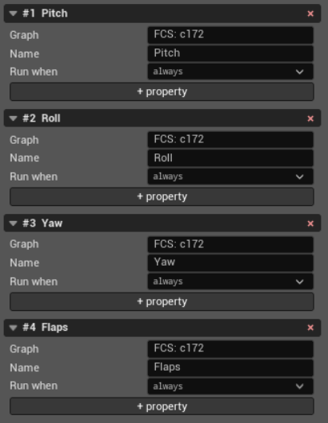

Logic Graphs
============

Logic graphs define the vehicle's control logic as ordered channels of blocks.
A block reads properties, calculates a value, and publishes that value as a
property for later blocks or the flight model. Wires in the graph are a visual
representation of matching property names; they are not stored separately.

An aircraft can contain many channels. In the aircraft tree, each channel is
shown separately, such as **Pitch**, **Roll**, **Yaw**, and **Flaps** below.

Channels
--------

**Graph**
   Groups channels into one graph and one tab in the graph window. Channels
   with the same value are displayed together. For a graph created in the
   editor, this name also becomes the control-system file name. An imported
   graph keeps the file and section from which it was loaded.

**Name**
   The channel label shown in the aircraft tree, graph lane, and JSBSim log.
   It does not create a property and does not determine what the channel
   controls.

**Run when**
   Selects a property that enables the channel. **always** leaves the channel
   enabled continuously. Otherwise, zero disables the channel and a nonzero
   value enables it. The menu contains properties declared by the logic graphs
   and properties published by the loaded model.

   The selected property must exist when the model loads. A missing property
   prevents the model from loading, so arbitrary text cannot be entered in
   this field. Declare a new property first if it must be used here.

**+ property**
   Declares a property owned by this control system. A new declaration starts
   at zero. Declared properties can enable channels, feed blocks, or hold
   settings used elsewhere in the graph. The red **x** beside a declaration
   removes it; any channel or block that still depends on that property must
   be changed before the model can load.

The red **x** in a channel header removes that channel and all its blocks.
**+ Add channel** creates another channel. When channels already exist, the
new channel joins the same graph and source section as the last channel.

Open the graph
--------------

Select any logic-graph channel in the aircraft tree, then press **Open logic
graph** below the channel list. The window contains one tab per **Graph** name
and one horizontal lane per channel in that graph. Channels and blocks execute
in their listed order. A block can therefore consume a value published by an
earlier block.

The graph window uses the following controls:

* **+ Block** or a double-click on empty canvas opens the block-type menu. A
  new block is appended to the last channel in the active graph.
* Drag a node to change only its saved layout. Dragging does not change its
  execution order; **Runs** in the inspector shows that order.
* Drag from an output pin to an input pin to make that input read the output's
  property. A new connection replaces the previous property on that input.
* Click an input pin to clear it. An input with no publisher in the displayed
  graph remains as a short unconnected line; it may be an external property
  or a misspelling.
* Right- or middle-drag pans the canvas. The mouse wheel zooms. Drag the title
  bar to move the window and its lower-right corner to resize it.
* Select a node to open its inspector. **Delete** or **Backspace** removes the
  selected block. Other blocks that read its property are not rewritten and
  become unconnected until corrected.

The canvas draws a wire by matching an input path to a published path. If two
blocks publish the same path, the simulator keeps the value written later in
execution order. The graph warns about duplicate publishers when the vehicle
is written.

Common block fields
-------------------

**Name**
   Identifies the block and defines its implicit output property. A name that
   is already a path is used directly. Otherwise it is converted to lower
   case, spaces become dashes, and it is placed under ``fcs/``.

**Publishes to**
   Shows the implicit output path produced from **Name**. This field is
   read-only.

**Input**
   The property read by the block. It can be typed in the inspector or filled
   by connecting a wire. The checkbox before an input negates it. Most blocks
   require exactly one input; **summer** accepts any number, while blocks that
   evaluate their own conditions or properties have none.

**delay**
   Holds the block's result back by the specified time. With **frames** clear,
   the value is seconds; with it selected, the value is simulation frames.
   Zero disables the delay. **linear_actuator** ignores this field and does
   not display it.

**Clip to**
   Limits the result between the minimum and maximum. Both bounds must be
   filled or neither is written. A bound can be a number or a property.
   **linear_actuator** ignores clipping and does not display these fields.

**Output**
   Adds another property that receives the same result. Removing every
   explicit output does not remove the implicit output derived from **Name**.

**Runs**
   Shows the block's position in its channel's execution order. It is
   read-only; blocks added in the editor are appended to the channel.

Where a block field accepts a number, it also accepts a property path. The
block then reads the field's value from that property every simulation step.

Block types
-----------

Gain and summing
~~~~~~~~~~~~~~~~

**pure_gain**
   Multiplies its input by **gain**. An omitted gain is written as ``1``.

**summer**
   Adds all its inputs, applying each input's negate checkbox, then adds the
   optional **bias**. Use **+ input** to add terms.

**scheduled_gain**
   Multiplies the input by **gain** and by a one-dimensional lookup table.
   **Looks up** selects the independent property. **Rows** contains one input
   and output pair per line; lookup values must increase. Values beyond the
   first or last row use the endpoint value.

Controllers and signal shaping
~~~~~~~~~~~~~~~~~~~~~~~~~~~~~~

**pid**
   Applies proportional, integral, and derivative control to one input.
   **kp**, **ki**, and **kd** are the three gains. **trigger** names an
   anti-windup property: zero allows integration, a positive value pauses it,
   and a negative value clears the integral. **pvdot** supplies an external
   derivative instead of differentiating the input. The **type** attribute is
   empty for the parallel form or ``standard`` for the standard form, where
   **kp** also multiplies the integral and derivative terms.

**integrator**
   Integrates its input over time and multiplies the accumulated result by
   **c1**. **trigger** pauses integration while positive and resets the
   accumulated value while negative.

**lag_filter**
   Applies a first-order low-pass filter. **c1** sets its frequency
   coefficient; a larger value follows input changes more quickly.

**washout_filter**
   Applies a first-order high-pass filter that removes steady input. **c1** is
   the filter coefficient and is required.

**lead_lag_filter**
   Applies the transfer function ``(c1*s + c2) / (c3*s + c4)``. All four
   coefficients are required.

**second_order_filter**
   Applies ``(c1*s^2 + c2*s + c3) / (c4*s^2 + c5*s + c6)``. All six
   coefficients are required.

**deadband**
   Removes a region of width **width** around zero. Input outside that region
   is shifted toward zero so the output remains continuous. Optional **gain**
   scales the remaining output.

Actuation and travel
~~~~~~~~~~~~~~~~~~~~

**actuator**
   Models a mechanical actuator. **lag** smooths changes; **rate_limit** caps
   how quickly the result changes; **deadband_width** removes small commands;
   **hysteresis_width** gives rising and falling motion different thresholds;
   and **bias** offsets the result. Empty fields leave that effect disabled.

**aerosurface_scale**
   Maps one input range to a surface-position range. **domain.min** and
   **domain.max** define the input range. Required **range.min** and
   **range.max** define the output range. **gain** multiplies the result.
   **zero_centered** keeps zero fixed while scaling the positive and negative
   sides separately; set it to ``0`` or ``false`` for one linear mapping from
   the domain minimum to maximum.

**kinematic**
   Moves the output through ordered **Stops**. Each line contains a position
   and the time in seconds needed to reach it from the preceding stop. At
   least two stops are required. With **Input is already in units** clear,
   input is treated as a fraction of the final stop; when selected, input uses
   the stop positions directly.

**linear_actuator**
   Models an incremental linear or rotary mechanism. **set** enables updates
   and **reset** clears its stored position. **versus** restricts accepted
   motion to one direction: positive, negative, or unrestricted at zero.
   **module** is the size of one complete increment, **rate** is the fraction
   of that increment used as the wrap threshold, and **hysteresis** is the
   minimum input change accepted. **bias** offsets the stored position,
   **gain** scales the result, and **lag** filters it. This type uses its own
   state handling and ignores the common **delay** and **Clip to** fields.

Conditions and formulas
~~~~~~~~~~~~~~~~~~~~~~~

**switch**
   Evaluates cases in order and publishes the value of the first matching
   case. **Case gives** accepts a number or property. **When** contains one
   condition per line using ``LT``, ``LE``, ``EQ``, ``GE``, ``GT``, or ``NE``.
   With **Any one is enough** clear, every condition in the case must hold;
   when selected, any condition is sufficient. **Otherwise** is used when no
   case matches and defaults to zero when empty.

**fcs_function**
   Computes a formula with the same property, number, arithmetic, comparison,
   conditional, lookup, and other operators used by Aerodynamics functions.
   An incomplete formula is not written; the block keeps its last valid
   formula until the edit becomes valid.

**distributor**
   Writes values directly to one or more properties when a case matches.
   **Case when** contains one condition per line. **sets** contains a property
   followed by its value on each line. The **type** attribute is
   ``inclusive`` to run every matching case or ``exclusive`` to stop after the
   first match.

Angles and navigation
~~~~~~~~~~~~~~~~~~~~~

**angle**
   Calculates the signed shortest difference from **source_angle** to
   **target_angle**. Both fields must be property paths. The **in** field below
   each angle is ``DEG`` for degrees; empty or any other value means radians.
   The block's **unit** is ``DEG`` or ``RAD`` and selects the output unit.

**waypoint_heading**
   Calculates the initial heading from the source coordinate to the target
   coordinate. **source_latitude**, **source_longitude**,
   **target_latitude**, and **target_longitude** must be property paths. Their
   **in** fields use ``DEG`` for degrees and radians otherwise. The block's
   **unit** selects a ``DEG`` or ``RAD`` result.

**waypoint_distance**
   Uses the same four coordinate properties to calculate great-circle
   distance. Their **in** fields use ``DEG`` for degrees and radians otherwise.
   The block's required **unit** is ``M`` for metres or ``FT`` for feet.

Imported block types that the editor does not support remain in the file
unchanged. Their names, inputs, and outputs still participate in the graph,
but their type-specific contents cannot be edited.
