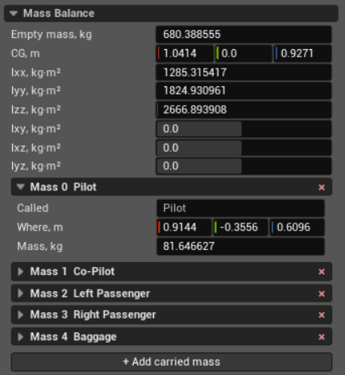

Mass Balance
============

Mass Balance defines the empty aircraft's mass, centre of gravity, and inertia.
Carried masses are added to these values when JSBSim calculates the loaded
aircraft. This section does not move or resize the visual meshes.

The three boxes in **CG** and **Where** are X, Y, and Z from left to right.
They use the structural frame: X points aft, Y right, and Z up.

Aircraft
--------

**Empty mass, kg**
   The mass of the aircraft without fuel or the carried masses listed below.
   Include the airframe and installed equipment that are part of the empty
   aircraft. The value must be greater than zero.

**CG, m**
   The centre of gravity of the empty aircraft, measured from the structural
   origin. JSBSim combines it with fuel and carried masses to calculate the
   loaded centre of gravity. A positive X value moves the empty-aircraft CG
   aft, a positive Y value moves it right, and a positive Z value moves it up.

**Ixx, kg·m²**
   The empty aircraft's roll moment of inertia about the X axis through its CG.
   A larger value produces less roll acceleration from the same rolling
   moment. The value must be greater than zero.

**Iyy, kg·m²**
   The empty aircraft's pitch moment of inertia about the Y axis through its
   CG. A larger value produces less pitch acceleration from the same pitching
   moment. The value must be greater than zero.

**Izz, kg·m²**
   The empty aircraft's yaw moment of inertia about the Z axis through its CG.
   A larger value produces less yaw acceleration from the same yawing moment.
   The value must be greater than zero.

**Ixy, kg·m²**
   The product of inertia coupling rotation about the X and Y axes. It is
   normally zero when the aircraft is symmetric and the selected axes are
   principal axes.

**Ixz, kg·m²**
   The product of inertia coupling rotation about the X and Z axes. Use the
   value calculated for the aircraft's mass distribution; an arbitrary value
   introduces unintended coupling between roll and yaw.

**Iyz, kg·m²**
   The product of inertia coupling rotation about the Y and Z axes. It is
   normally zero for an aircraft symmetric about its longitudinal plane.

The three diagonal moments must be positive, and all six values together must
describe a physically valid inertia tensor. If any cross product is nonzero,
the editor also shows **Negate cross inertia**. Keep it selected for the
default JSBSim convention used by aircraft files; clear it only when the
source values are plain, non-negated products of inertia.

Carried mass
------------

Use **+ Add carried mass** for a pilot, passenger, baggage, battery, or other
mass carried at a specific point. Each entry changes the loaded mass, centre
of gravity, and inertia. Passengers can be added in the same way; the expanded
**Pilot** entry above shows all fields:

**Called**
   A descriptive name for the mass. It identifies the entry in the editor and
   logs but does not change the simulation.

**Where, m**
   The mass's position in the structural frame. In the example, the pilot is
   0.9144 m aft, 0.3556 m left, and 0.6096 m above the structural origin.

**Mass, kg**
   The carried mass. The example pilot weighs 81.64627 kg. JSBSim adds it to
   the empty aircraft and accounts for its position when calculating the
   loaded CG and inertia.

Use the red × on the entry header to remove a carried mass.
