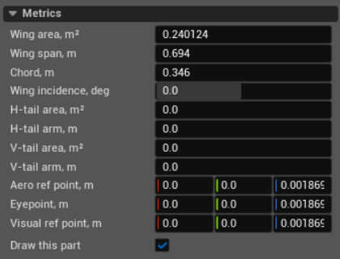

Metrics
=======

Metrics defines the reference geometry and reference points used by the JSBSim
flight model. It does not resize or move the meshes in ``Visual.xml``.

Fields
------

The three boxes in each point field are X, Y, and Z from left to right. These
points use the JSBSim structural frame: X points aft, Y right, and Z up.

**Wing area, m²**
   The reference wing area, usually written as *S*. JSBSim combines it with
   dynamic pressure to provide ``qbar × S``, which aerodynamic functions use
   to turn dimensionless coefficients into forces. It is a reference value,
   not an area calculated from the visual mesh. The value must be greater than
   zero.

**Wing span, m**
   The reference distance from one wingtip to the other, usually written as
   *b*. JSBSim uses it as the lateral reference length for aerodynamic rates
   and coefficients. It is also used when JSBSim calculates the vertical-tail
   volume coefficient. The value must be greater than zero.

**Chord, m**
   The mean aerodynamic chord, usually written as *c̄*. It is the longitudinal
   reference length for aerodynamic rates and pitching moments. JSBSim also
   uses it to calculate the horizontal-tail volume coefficient and Reynolds
   number. The value must be greater than zero.

**Wing incidence, deg**
   The angle between the wing reference line and the aircraft body axis.
   Positive incidence increases the wing's effective angle of attack while the
   body attitude stays unchanged. The editor accepts values from -90 to 90
   degrees.

**H-tail area, m²**
   The reference area of the horizontal tail. Together with **H-tail arm**, wing
   area, and chord, it defines the horizontal-tail volume coefficient:
   ``arm × tail area / (chord × wing area)``. This value does not create a tail
   force by itself; an aerodynamic function must use the resulting metric.

**H-tail arm, m**
   The horizontal tail's reference lever arm. PteroSim draws it aft from the
   aerodynamic reference point. JSBSim uses it to calculate the normalized
   horizontal-tail arm and horizontal-tail volume coefficient. Use zero when
   the model does not use these derived metrics.

**V-tail area, m²**
   The reference area of the vertical tail. Together with **V-tail arm**, wing
   area, and wing span, it defines the vertical-tail volume coefficient:
   ``arm × tail area / (wing span × wing area)``. This value does not create a
   side force or yawing moment by itself.

**V-tail arm, m**
   The vertical tail's reference lever arm. PteroSim draws it aft from the
   aerodynamic reference point. JSBSim uses it to calculate the normalized
   vertical-tail arm and vertical-tail volume coefficient. Use zero when the
   model does not use these derived metrics.

**Aero ref point, m**
   The point where JSBSim applies the resulting aerodynamic forces. Its offset
   from the centre of gravity determines the additional moment produced by
   those forces. Place it at the aerodynamic reference point used when deriving
   the model's coefficients.

**Eyepoint, m**
   The pilot's eye position. JSBSim uses its offset from the centre of gravity
   when calculating accelerations sensed by the pilot during rotation. It does
   not position a PteroSim camera; cameras are configured under
   :doc:`sensors`.

**Visual ref point, m**
   The point whose world position JSBSim reports to an external visual system.
   It does not move meshes authored in ``Visual.xml``. PteroSim retains the
   value and shows the point in debug drawing.

**Draw this part**
   Enables the Metrics debug visualization. When **Show debug draw** is also
   enabled for the vehicle, PteroSim displays the structural frame, reference
   points, wing span and chord, and configured tail arms. This setting does not
   change the flight model.
