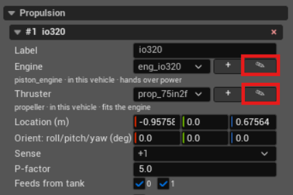
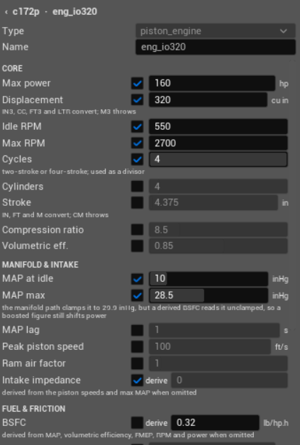
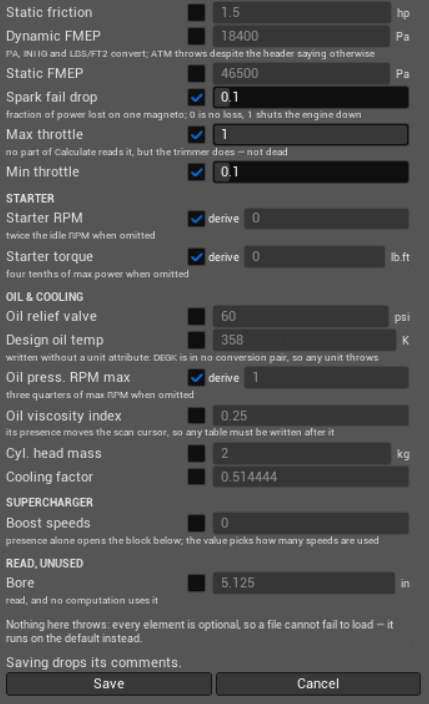
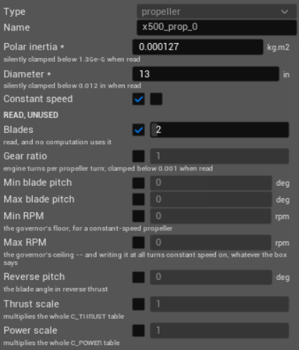
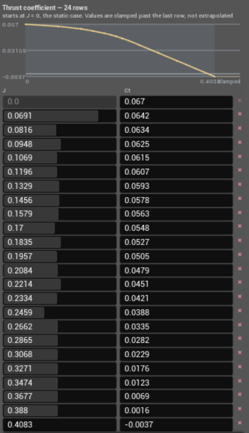
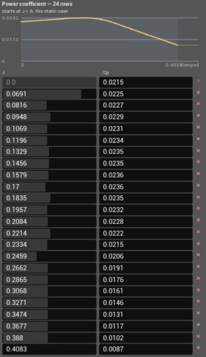

Propulsion
==========

Propulsion defines the units that generate force in the JSBSim flight model.
Each unit is one engine and one thruster. The engine produces shaft power or
thrust, and the thruster converts that output into forces and moments.

Use **+ Add** > **Motor** to add a propulsion unit. A new unit uses the first
available ``Motor_N`` label, the ``DJI_E305`` engine, the ``DJI_9450``
thruster, the structural origin, 90 degrees of pitch, and ``+1`` sense. These
are initial values, not values calculated from the aircraft.

The number in the component header and the number under :doc:`inputs` use
different bases. The first component is ``#1`` in Propulsion and ``Motor 0``
in Inputs. Component order is the JSBSim engine index. Removing a component
renumbers every component after it and therefore changes its corresponding
Motor number under Inputs.

**Label** is the case-sensitive name used by a propeller in :doc:`parts` to
find the motor that spins it. Renaming a motor does not update that reference.
If the names no longer match, the visual propeller is not shown. The label
does not identify the engine inside JSBSim; the engine index does.

A Propulsion component does not add mass or create a visible mesh. Include
installed propulsion mass under :doc:`mass_balance` and add visible parts
under :doc:`parts`.

Engine
------

The engine definition determines how a control input becomes shaft power or
thrust. The selected file also determines which controls, starting procedure,
fuel consumption, electrical consumption, and engine state are available to
JSBSim.

Power-producing engines drive a propeller or rotor. The supported types are
``brushless_dc_motor``, ``electric_engine``, ``piston_engine``, and
``turboprop_engine``. Thrust-producing engines drive a direct thruster or
nozzle. The supported types are ``turbine_engine`` and ``rocket_engine``.

**Engine selector**
   Selects the engine definition by filename without ``.xml``. The list
   contains definitions stored with this aircraft and retains the currently
   selected name. It does not list the complete shared catalogue.

   The line below the selector reports the definition type, whether the file
   belongs to this aircraft or the read-only catalogue, and whether the
   engine outputs power or thrust. **Apply to FDM** is refused if the selected
   name cannot be resolved to a definition file.

**+**
   Creates an engine definition in the aircraft's own ``Engines`` directory
   and selects it for this component. The available types are limited to
   definitions the editor can create without missing required tables or
   functions.

**Pencil**
   Opens the selected definition. A definition already stored with the
   aircraft is edited in place. A read-only catalogue definition is copied
   into the aircraft first; the catalogue file is not modified.

   In a new definition, **Type** selects the JSBSim engine model and determines
   which fields are shown. In an existing definition it identifies the model
   already stored in the file. **Name** becomes the local definition filename
   and its internal name. A selected checkbox writes that value to the file.
   Clearing an optional value omits it and lets JSBSim use its built-in
   default. Clearing a value marked **derive** omits it and lets JSBSim
   calculate it from the other fields. Required values cannot be omitted.
   Saving rewrites the definition and does not preserve XML comments.

**Feeds from tank**
   Each checkbox selects a tank by its zero-based index under :doc:`tanks`.
   A fuel-burning engine draws only from the selected tanks. With no selected
   tank it receives no fuel and cannot start. Electric and brushless motors do
   not read fuel feeds and can run without a tank.

The engine output must match what the selected thruster accepts. The editor
filters the Thruster selector after an engine is selected, and **Apply to
FDM** refuses an existing pair whose output types do not match.

Piston engine definition
^^^^^^^^^^^^^^^^^^^^^^^^

The ``piston_engine`` form exposes every scalar that the PteroSim editor can
write for the JSBSim piston-engine model. All fields are optional: a cleared
checkbox omits the element and JSBSim substitutes its default. A checked
**derive** box also omits the element, but indicates that its value is
calculated from other engine fields.

**Type**
   Identifies the JSBSim engine model. It is fixed to ``piston_engine`` when an
   existing piston definition is edited.

**Name**
   Sets both the definition filename and the ``name`` attribute inside it.
   Saving also changes the Engine selector of the current Propulsion component
   to this name.

Core
~~~~

**Max power, hp**
   Nominal power at **Max RPM**. It sets the engine's power scale and is also
   used when JSBSim derives BSFC and starter performance.

**Displacement, cu in**
   Total swept cylinder volume. It determines air mass flow and fuel flow, so
   it affects power production and engine cooling.

**Idle RPM**
   Reference idle speed used to shape the low-throttle response. The engine
   starts running after reaching 80 percent of this speed and stops if it
   falls below that threshold.

**Max RPM**
   Reference speed at which **Max power** is specified. JSBSim also uses it to
   calculate intake resistance, derived BSFC, and oil pressure.

**Cycles**
   Number of crankshaft revolutions per power cycle. JSBSim uses it as a
   divisor in the power calculation; set it to match a two-stroke or
   four-stroke engine.

**Cylinders**
   Number of cylinders. It scales the total cylinder-head thermal mass used by
   the temperature model.

**Stroke, in**
   Piston travel from top to bottom dead centre. Together with RPM it sets mean
   piston speed and therefore the loss of breathing efficiency at high speed.

**Compression ratio**
   Ratio of maximum to minimum cylinder volume. JSBSim uses it when changing
   volumetric efficiency with altitude. The value must be greater than one.

**Volumetric eff.**
   Nominal ratio between the inducted air volume and the engine displacement.
   It directly affects air flow, fuel flow, and power; boosted engines may use
   a value greater than one.

Manifold & intake
~~~~~~~~~~~~~~~~~

**MAP at idle, inHg**
   Nominal sea-level manifold absolute pressure at idle without boost. With
   **Idle RPM**, it defines the low end of the throttle-to-manifold-pressure
   response.

**MAP max, inHg**
   Nominal sea-level manifold absolute pressure at maximum throttle without
   boost. JSBSim clamps the ordinary manifold path to 29.9 inHg, but the
   unclamped value still affects derived BSFC and can therefore represent a
   boosted power rating.

**MAP lag, s**
   Delay applied to changes in manifold pressure. Increasing it makes the
   manifold pressure and engine response change more slowly after a throttle
   movement.

**Peak piston speed, ft/s**
   Mean piston speed at which the intake begins to choke. Above this point,
   increasing RPM produces progressively less air flow.

**Ram air factor**
   Multiplier for the dynamic-pressure contribution to manifold pressure.
   Zero disables ram-air recovery; larger values increase manifold pressure
   with airspeed.

**Intake impedance**
   Pressure-loss factor of the intake upstream of the throttle. Increasing it
   reduces available manifold pressure. With **derive** selected, JSBSim
   calculates it from piston-speed and maximum-MAP data.

Fuel & friction
~~~~~~~~~~~~~~~

**BSFC, lb/hp.h**
   Brake-specific fuel consumption: fuel mass used per horsepower-hour.
   Increasing it raises fuel flow for the same power. With **derive** selected,
   JSBSim calculates it from MAP, volumetric efficiency, friction, RPM, and
   maximum power.

**Static friction, hp**
   Constant power required to turn an engine that is not producing power. It
   slows a windmilling engine and propeller and is subtracted from generated
   power.

**Dynamic FMEP, Pa**
   Speed-dependent friction mean effective pressure. JSBSim combines this
   coefficient with mean piston speed to calculate the part of internal
   friction that rises with RPM.

**Static FMEP, Pa**
   Constant friction mean effective pressure. It represents internal pumping
   and mechanical losses that do not scale with piston speed.

**Spark fail drop**
   Fraction of power lost when only one magneto is operating. Zero produces no
   loss; one removes all power during single-magneto operation.

**Max throttle**
   Upper normalized throttle limit used by the JSBSim trimmer. The piston
   engine's runtime power calculation does not clamp live throttle to this
   value.

**Min throttle**
   Lower normalized throttle limit stored with the engine definition. It
   defines the lower end of the engine's throttle range for systems that read
   the engine limits.

Starter
~~~~~~~

**Starter RPM**
   Maximum crankshaft speed reached by an unloaded starter. Propeller load and
   engine resistance reduce the actual cranking speed. With **derive**
   selected, JSBSim uses twice **Idle RPM**.

**Starter torque, lb.ft**
   Starter torque at zero RPM. Available torque decreases as the crankshaft
   approaches **Starter RPM**. With **derive** selected, JSBSim derives it from
   **Max power**.

Oil & cooling
~~~~~~~~~~~~~

**Oil relief valve, psi**
   Oil-pressure limit imposed by the relief valve. Oil pressure cannot rise
   above this value.

**Design oil temp, K**
   Reference operating oil temperature used by the oil-temperature model. The
   editor writes the value without a unit attribute because JSBSim does not
   provide a conversion for this element.

**Oil press. RPM max**
   Engine speed at which the oil pump reaches the relief-valve pressure before
   viscosity correction. With **derive** selected, JSBSim uses three quarters
   of **Max RPM**.

**Oil viscosity index**
   Coefficient used to vary oil pressure with oil temperature. Its XML element
   must remain before any piston-engine tables; the editor preserves that
   ordering when it writes the definition.

**Cyl. head mass, kg**
   Thermal mass of one cylinder head. JSBSim multiplies it by **Cylinders**;
   increasing it slows cylinder-head temperature changes.

**Cooling factor**
   Efficiency multiplier for the aircraft's engine-cooling airflow. Increasing
   it increases heat removal from the cylinder heads.

Supercharger
~~~~~~~~~~~~

**Boost speeds**
   Number of discrete supercharger ratios. Zero selects a naturally aspirated
   engine; one to three enables the corresponding boost stages. Checking this
   field makes the remaining supercharger fields available, while its value
   controls how many numbered stages JSBSim uses.

**Override**
   Enables the boost-regulator override when set to one. Without the override,
   manifold pressure is clipped to the rated wastegate limit.

**Manual**
   Selects manual boost-stage switching. When cleared, JSBSim changes stages
   automatically; when selected, the active stage follows the engine's
   ``boostspeed`` control property.

**Take-off boost, psi**
   Additional boost above sea-level ambient pressure available at the
   take-off throttle setting. It changes the regulator target, not the
   mechanical supercharger ratio.

**Boost loss factor**
   Multiplier for the shaft power consumed while compressing intake air. Zero
   models boost without a power cost; a positive value subtracts compressor
   power from engine output.

**Rated boost 1/2/3, psi**
   Rated boost above sea-level ambient pressure for each enabled stage. A zero
   value for an enabled first stage fails validation and causes JSBSim to drop
   the boosted configuration.

**Rated power 1/2/3, hp**
   Rated power recorded for each boost stage. JSBSim checks that the value is
   nonzero when validating a stage but does not use it in the power
   calculation.

**Rated RPM 1/2/3**
   Engine speed at which the corresponding stage develops its rated boost.

**Rated altitude 1/2/3, ft**
   Highest altitude at which the corresponding stage can maintain rated
   boost. Above it, manifold pressure falls because the stage is already at
   its maximum unregulated pressure ratio. Zero leaves that stage
   unregulated.

Read, unused
~~~~~~~~~~~~

**Bore, in**
   Cylinder diameter. JSBSim reads and stores the value, but the piston-engine
   calculations do not use it.

Thruster
--------

The thruster definition determines how engine output becomes force, reaction
torque, RPM, and gyroscopic effects. ``propeller`` and ``rotor`` definitions
accept shaft power. ``direct`` and ``nozzle`` definitions accept thrust.

**Thruster selector**
   Selects the thruster definition by filename without ``.xml``. The list
   contains compatible definitions stored with this aircraft and retains the
   currently selected name. It does not list the complete shared catalogue.

   The line below the selector reports the definition type, file location,
   and compatibility with the selected engine. **Apply to FDM** is refused if
   the name cannot be resolved or the definition reads a different output
   type from the engine.

**+**
   Starts a compatible thruster definition in the aircraft's own ``Engines``
   directory. The available types are filtered by the selected engine's output.
   Saving requires every mandatory scalar and performance table. Use the
   pencil button to copy an existing definition when those data must be
   retained and edited.

**Pencil**
   Opens the selected thruster definition. Editing a catalogue definition
   first copies it into the aircraft. The form follows the same checkbox,
   required-value, and derived-value rules as the engine form.

Propeller definition
^^^^^^^^^^^^^^^^^^^^

The ``propeller`` definition contains the propeller's dimensions, rotational
properties, governor limits, and the coefficient tables used to calculate its
thrust and shaft-power demand.

**Type**
   Definition type. ``propeller`` accepts shaft power from a compatible engine
   and converts it into axial thrust, reaction torque, RPM, and gyroscopic
   moments.

**Name**
   Name written inside the definition. The selector uses the XML filename;
   these names should remain the same so the file and its contents identify
   the same propeller.

**Polar inertia, kg.m2**
   Propeller moment of inertia about its shaft. JSBSim uses it when integrating
   RPM from the difference between engine torque and aerodynamic load, and for
   the propeller's gyroscopic moment. A larger value makes RPM change more
   slowly. This field is required; values below ``1.36e-6`` kg.m2 are clamped
   when read.

**Diameter, in**
   Tip-to-tip propeller diameter. It is required and directly scales both
   performance equations: thrust is proportional to diameter to the fourth
   power, while absorbed power is proportional to diameter to the fifth power.
   Values below ``0.012`` in are clamped when read.

**Constant speed**
   Enables the blade-pitch governor. The governor varies pitch within **Min
   blade pitch** and **Max blade pitch** to hold a commanded RPM within the
   configured RPM limits. With the option disabled, pitch follows the propeller
   pitch command directly. Writing **Max RPM** also enables constant-speed mode
   when no explicit ``Constant speed`` value overrides it.

**Blades**
   Number of blades recorded in the XML file. JSBSim reads the value, but its
   propeller calculations do not use it.

**Gear ratio**
   Number of engine revolutions per propeller revolution. It converts engine
   RPM and torque to shaft RPM and torque. ``1`` is direct drive; JSBSim clamps
   values below ``0.001``.

**Min blade pitch, deg**
   Lowest blade angle available to the pitch command or constant-speed
   governor. Together with **Max blade pitch**, it limits which operating point
   the governor can reach. Equal minimum and maximum values define a
   fixed-pitch propeller.

**Max blade pitch, deg**
   Highest blade angle available to the pitch command or constant-speed
   governor. It must not be lower than **Min blade pitch**.

**Min RPM**
   Lower governor target. The commanded propeller RPM cannot fall below this
   value while constant-speed control is active.

**Max RPM**
   Upper governor target. The commanded propeller RPM cannot exceed this value
   while constant-speed control is active. Including this field in the XML
   enables constant-speed mode unless ``Constant speed`` is explicitly written
   as disabled.

**Reverse pitch, deg**
   Blade angle commanded in reverse-thrust mode. It defines the reverse setting
   independently of the normal minimum-pitch limit.

**Thrust scale**
   Multiplies every coefficient obtained from the **Thrust coefficient** table.
   It scales the complete thrust curve without changing each table row.

**Power scale**
   Multiplies every coefficient obtained from the **Power coefficient** table.
   It scales the complete shaft-power load curve without changing each table
   row.

Coefficient tables
~~~~~~~~~~~~~~~~~~

Both graphs plot a dimensionless coefficient against advance ratio ``J``. The
advance ratio is axial airspeed divided by propeller revolutions per second and
diameter: ``J = V / (n D)``. ``J = 0`` is the static condition. Increasing
``J`` means that the propeller advances farther through the air during each
revolution.

Each row below a graph is one lookup point. The left column is ``J`` and the
right column is the corresponding coefficient. JSBSim interpolates between
the rows and clamps lookups outside the table to the nearest endpoint instead
of extrapolating. The first row must be at ``J = 0``, later ``J`` values must
increase, and each table must contain at least two rows. The row count in the
heading is only the number currently stored in that definition.

**Thrust coefficient**

The ``C_THRUST`` curve supplies thrust coefficient ``Ct`` for the current
advance ratio. JSBSim calculates thrust from ``Ct``, air density, propeller RPM,
and diameter. The graph therefore defines how thrust changes as forward speed
and RPM change. A positive value produces thrust in the propeller's forward
direction; a negative value represents aerodynamic braking. **Thrust scale**
is applied after the table lookup.

**Power coefficient**

The ``C_POWER`` curve supplies power coefficient ``Cp`` for the current advance
ratio. JSBSim calculates the shaft power absorbed by the propeller from ``Cp``,
air density, RPM, and diameter. This load is converted to torque and balanced
against engine output when RPM is updated. A larger ``Cp`` means a larger power
demand at the same density, RPM, and diameter. **Power scale** is applied after
the table lookup.

**Location (m)**
   The point where JSBSim applies the thruster force. The three boxes are X,
   Y, and Z in the structural frame: X points aft, Y right, and Z up. The
   offset from the centre of gravity determines the moments produced by the
   force. A visual propeller linked to this motor also uses this point as its
   shaft position.

**Orient: roll/pitch/yaw (deg)**
   Rotates the thruster from the aircraft body axes. With all three values at
   zero, thrust points forward along body +X. Positive pitch rotates thrust
   upward; 90 degrees points it vertically upward. Positive yaw rotates thrust
   to the aircraft's right.

   Roll is rotation about the thrust axis. It does not change a propeller's
   force, torque, or gyroscopic-moment direction. The rotor model uses roll as
   part of its rotor orientation.

**Sense**
   Sets the direction of rotation and the sign of the reaction torque. Its
   convention depends on the thruster type:

   * For a propeller, ``+1`` is clockwise when viewed from the cockpit side,
     looking forward along the thrust axis. ``-1`` is the opposite direction.
     For an upward-pointing multirotor propeller, ``+1`` therefore appears
     counter-clockwise when viewed from above.
   * For a rotor viewed from above, ``+1`` is counter-clockwise and ``-1`` is
     clockwise. ``0`` represents a coaxial pair with no reaction torque.
   * Direct thrusters and nozzles do not read Sense; the control is disabled
     for those types.

**P-factor**
   Appears only for a propeller. It moves the effective thrust application
   point as the angle of the incoming airflow changes. This produces a yawing
   moment at nonzero angle of attack; its direction depends on **Sense**. Zero
   disables the effect.

The red × removes the propulsion unit. Recheck the Motor destinations under
:doc:`inputs` after removal because all later engine indices change.
