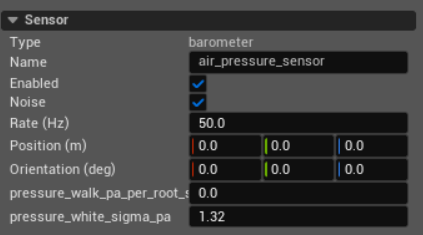
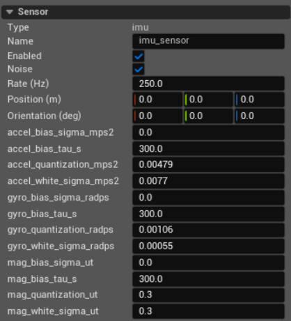
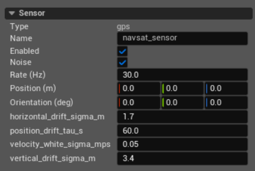
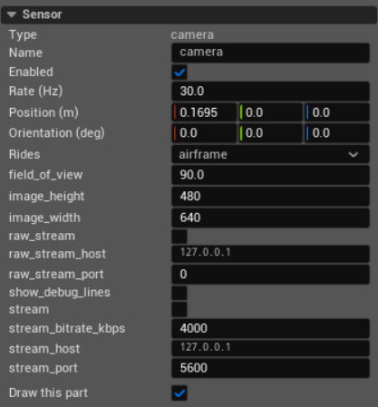

Sensors
=======

Sensors are defined in ``Sensors.xml``. A vehicle may contain multiple sensors
of the same type. Each one has its own name, pose, update rate, and noise
state. The SDK addresses sensors by name. For the barometer, IMU, and GPS, an
autopilot connector uses the first component of each required type; adding
redundant physical sensors does not make the connected autopilot fuse all of
them. Multiple active camera streams are announced separately.

The add menu offers ``airspeed``, ``barometer``, ``camera``, ``depthcamera``,
``gps``, ``imu``, and ``temperature`` sensors. This page covers the barometer,
IMU, GPS, and onboard streaming camera. Airspeed data is also sent to PX4
through ``HIL_SENSOR``. Depth-camera, airspeed, and temperature fields are not
covered here.

Common fields
-------------

**Type**
   The sensor model. This field is read-only. To change the type, remove the
   sensor and add a new one.

**Name**
   The sensor's address in the editor, ``Sensors.xml``, and the SDK. It must
   be non-empty and unique among the vehicle's sensors without regard to
   letter case.

**Enabled**
   Installs or removes the sensor's data source. A disabled sensor produces no
   samples. The first IMU must be enabled for HIL telemetry. The first GPS must
   be enabled for PX4 and Betaflight; ArduPilot does not require one. A
   barometer is optional; PX4 barometer fields are omitted when the first
   barometer is absent or disabled.
   A later enabled sensor does not replace a disabled first sensor of the same
   type for these checks.

**Noise**
   Enables the complete measurement-error model for this sensor. Clearing it
   removes white noise, drifting bias, random walk, and quantization. It does
   not disable environmental effects already present in the simulated motion
   or atmosphere.

   Noise streams are independent for each sensor and measured quantity. A
   fixed simulation seed reproduces them; a seed of zero creates a new run.
   Stateful errors start from zero when the episode is reset. Changing a
   sensor's name also changes its noise streams.

**Rate (Hz)**
   Requested reports per simulated second. The editor accepts 1 to 1000 Hz. At
   simulation start, a value above the physics rate is silently reduced to the
   physics rate. Samples can occur only on physics steps: PteroSim uses an
   integer step interval, so a value that does not divide the physics rate may
   produce a higher effective rate.

**Position (m)**
   Sensor position in the vehicle frame: X forward, Y right, and Z up. The IMU
   uses this offset to include angular-acceleration and centripetal effects at
   its mounting point. The current barometer and GPS models do not use their
   local position when calculating a reading.

**Orientation (deg)**
   Mount orientation as roll, pitch, and yaw. The IMU rotates accelerometer,
   gyroscope, and magnetometer readings into these mounted axes. The current
   barometer and GPS models do not use orientation.

**Rides**
   Appears on sensors that can be mounted on a gimbal. It selects the airframe
   or supported gimbal part that provides the sensor's parent frame. See
   :doc:`Aircraft Stores <aircraft_stores>` for gimbal stages and attachment
   rules.

Barometer
---------

The barometer reports absolute static pressure in hPa and pressure altitude in
metres. Pressure comes from the simulated atmosphere. PteroSim applies the
configured pressure error first, then converts that same error to altitude
with the current air density and the planet's gravity.

**pressure_walk_pa_per_root_s**
   Rate of an accumulating pressure random walk, in Pa per square root second.
   During a simulated interval ``dt``, its one-sigma change is this value
   multiplied by ``sqrt(dt)``. The error persists and continues wandering;
   zero disables it. It starts from zero when the noise state is reset.

**pressure_white_sigma_pa**
   Standard deviation of independent zero-mean Gaussian pressure error added
   to each reading, in Pa. Zero disables this source.

The two pressure errors are added together. A positive pressure error produces
a lower pressure-altitude reading. In a vacuum, pressure error still affects
the pressure value but cannot be converted to an altitude error.

IMU
---

The IMU contains a three-axis accelerometer, gyroscope, and magnetometer. With
zero **Orientation**, its outputs use the body frame with X forward, Y right,
and Z down. A non-zero orientation rotates the readings into the mounted sensor
axes.

Each instrument uses the same error order: independent white noise is added,
then a slowly varying bias, then the result is rounded by quantization. All
three stages are bypassed when **Noise** is cleared. Each sigma is the standard
deviation of the value added to one axis.

Accelerometer
~~~~~~~~~~~~~

The accelerometer reports specific force in m/s². **Position** changes the
reading when the vehicle rotates because the model includes angular-
acceleration and centripetal acceleration at the sensor mount.

**accel_bias_sigma_mps2**
   Stationary per-axis standard deviation of the correlated accelerometer
   bias, in m/s². The bias begins at zero and approaches this distribution
   over time. Zero disables accelerometer bias.

**accel_bias_tau_s**
   Correlation time of the accelerometer bias, in seconds. Larger values make
   the bias change more slowly. Zero makes an enabled bias behave as a fresh
   Gaussian offset. This field has no effect while
   **accel_bias_sigma_mps2** is zero.

**accel_quantization_mps2**
   Accelerometer resolution in m/s². The final value is rounded to the nearest
   multiple of this number. Zero disables quantization.

**accel_white_sigma_mps2**
   Standard deviation of independent Gaussian error on every accelerometer
   report, in m/s². Zero disables it.

Gyroscope
~~~~~~~~~

The gyroscope reports roll, pitch, and yaw angular rates about the mounted
sensor axes in rad/s.

**gyro_bias_sigma_radps**
   Stationary per-axis standard deviation of the correlated gyroscope bias,
   in rad/s. The bias begins at zero. Zero disables gyroscope bias.

**gyro_bias_tau_s**
   Correlation time of the gyroscope bias, in seconds. Larger values make the
   bias change more slowly. Zero makes an enabled bias behave as a fresh
   Gaussian offset. This field has no effect while
   **gyro_bias_sigma_radps** is zero.

**gyro_quantization_radps**
   Gyroscope resolution in rad/s. The final value is rounded to the nearest
   multiple of this number. Zero disables quantization.

**gyro_white_sigma_radps**
   Standard deviation of independent Gaussian error on every gyroscope
   report, in rad/s. Zero disables it.

Magnetometer
~~~~~~~~~~~~

The magnetometer reports the magnetic-field vector in µT. On Earth, PteroSim
uses the world position, attitude, and scene date to calculate the field. The
global field is zero on planets for which no field model is provided.

**mag_bias_sigma_ut**
   Stationary per-axis standard deviation of the correlated magnetometer
   bias, in µT. The bias begins at zero. Zero disables magnetometer bias.

**mag_bias_tau_s**
   Correlation time of the magnetometer bias, in seconds. Larger values make
   the bias change more slowly. Zero makes an enabled bias behave as a fresh
   Gaussian offset. This field has no effect while **mag_bias_sigma_ut** is
   zero.

**mag_quantization_ut**
   Magnetometer resolution in µT. The final value is rounded to the nearest
   multiple of this number. Zero disables quantization.

**mag_white_sigma_ut**
   Standard deviation of independent Gaussian error on every magnetometer
   report, in µT. Zero disables it.

The white-noise fields are per-report standard deviations. Changing
**Rate (Hz)** does not rescale them automatically.

GPS
---

The GPS reports latitude, longitude, altitude above sea level, NED velocity,
ground speed, and course over ground. Position error changes smoothly while
velocity uses independent error on each report. Ground speed and course are
calculated from the noisy velocity; course is held at zero below 0.1 m/s.

**horizontal_drift_sigma_m**
   One-sigma horizontal position error in metres. Independent north and east
   errors use this value. Each error starts at zero, reaches about 60% of the
   configured sigma after one **position_drift_tau_s**, and reaches nearly all
   of it after three. Zero disables horizontal position error.

**position_drift_tau_s**
   Correlation time shared by horizontal and vertical position error, in
   seconds. Larger values make the error move more slowly. Zero turns enabled
   position error into independent Gaussian error. This field has no effect
   when both position sigmas are zero.

**velocity_white_sigma_mps**
   Standard deviation of independent Gaussian error added to each north,
   east, and down velocity component on every report, in m/s. Zero disables
   velocity error.

**vertical_drift_sigma_m**
   One-sigma altitude error in metres. Positive error increases the reported
   altitude. The error starts at zero, reaches about 60% of the configured
   sigma after one **position_drift_tau_s**, and reaches nearly all of it after
   three. Zero disables vertical position error.

The simulated receiver always reports a 3D fix, 12 visible satellites, and
HDOP and VDOP of 1; these values are not editor fields. When noise is enabled,
PX4 also receives the horizontal and vertical drift sigmas as the GPS accuracy.
When noise is disabled, those reported accuracies are zero.

Camera
------

The camera sensor renders the view from a point on the vehicle. It is separate
from **Chase camera**: this component produces image frames for streaming and
the SDK. It also appears among the onboard views available through the vehicle
camera cycle. A vehicle may carry multiple camera sensors.

The camera has no **Noise** field. It captures the rendered scene directly.
Both output modes open on **Start**, close on **Stop** or a crash, and can be
enabled together. A single render is shared by every active output.

Camera placement
~~~~~~~~~~~~~~~~

**Position (m)** and **Orientation (deg)** set the optical viewpoint. With a
zero orientation the camera looks along its positive X axis, with Y right and
Z up in the vehicle frame.

**Rides**
   Selects **airframe** or the head of a gimbal. Position and orientation are
   measured in that parent frame. A camera on a gimbal moves and turns with
   the head; individual yaw and roll stages are not available here.

Image
~~~~~

**field_of_view**
   Horizontal field of view in degrees. The accepted range is 1 to 170
   degrees. It applies to captured frames and to the onboard view.

**image_height**
   Output height in pixels, from 64 to 4096.

**image_width**
   Output width in pixels, from 64 to 4096. Width and height set the output
   aspect ratio and the amount of image data that must be rendered, encoded,
   or transferred. Changing either dimension restarts an active H.264 encoder;
   the raw stream carries the dimensions in every frame header.

**show_debug_lines**
   Includes the world's debug line batches in the captured image. Clear it to
   keep paths and other line diagnostics out of vision data. This setting does
   not control the camera part's own editor visualization.

For a camera, **Rate (Hz)** is the requested frame rate in simulated time.
Rendering is also limited to one frame per rendered application frame; missed
instants are skipped rather than produced later. The H.264 stream additionally
limits delivery to this rate in wall-clock time.

H.264 RTP stream
~~~~~~~~~~~~~~~~

**stream**
   Sends the camera as an H.264 RTP stream over UDP while the simulation is
   running. PteroSim uses its bundled FFmpeg and writes an SDP description for
   the running stream. When a connected autopilot provides a MAVLink companion
   link, PteroSim advertises each active stream as a MAVLink camera so a ground
   station can discover its resolution, rate, bitrate, field of view, and RTP
   port.

   MAVLink start and stop streaming commands are acknowledged but do not open
   or close the encoder. The stream follows the PteroSim simulation state.

**stream_bitrate_kbps**
   Requested H.264 bitrate in kbit/s. The accepted range is 1 to 800000. This
   is the encoder target; the actual network rate also depends on the encoded
   scene and encoder.

**stream_host**
   Destination hostname or IP address that receives the UDP packets. It must
   contain only letters, digits, periods, and hyphens.

**stream_port**
   Base UDP port for RTP. The next port is reserved for RTCP, so the valid base
   range is 1 to 65534. The effective RTP port is the configured value plus
   twice the aircraft instance ID. PteroSim refuses to open a second active
   stream whose RTP/RTCP pair overlaps an existing camera stream.

Raw TCP stream
~~~~~~~~~~~~~~

**raw_stream**
   Opens a TCP server that sends lossless BGRA8 frames to connected clients.
   Frames use the little-endian PTF1 format: a header containing dimensions,
   row stride, frame and capture times, camera intrinsics, and camera pose,
   followed by packed image bytes. The camera does not render for this output
   until at least one client is connected.

**raw_stream_host**
   Local IPv4 address on which the TCP server listens. It must be a literal
   IPv4 address, not a hostname. ``127.0.0.1`` accepts clients from the same
   computer only; use an address of another interface when remote clients must
   connect.

**raw_stream_port**
   Base TCP listening port. It must be set to a value from 1 to 65535 before
   **raw_stream** can be enabled. The effective port is the configured value
   plus twice the aircraft instance ID. A port already used by another raw
   stream cannot be opened a second time.
