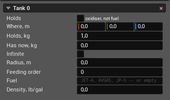

Tanks
=====

Tanks store the fuel or oxidizer consumed by propulsion. Their mass and
position are included in the loaded aircraft's mass, centre of gravity, and
inertia, so these properties change as a tank drains.

A vehicle can have any number of tanks. They are numbered from zero in their
order in the aircraft file. An engine's **Feeds from tank** checkboxes refer to
these numbers.

Use **+ Add** |rarr| **Tank** to add another tank. A new tank is created as an
empty fuel tank with 1 kg capacity. The fields below are shown for **Tank 0**;
every additional tank has the same fields.

**Holds**
   Selects what the tank contains. Clear **oxidiser, not fuel** for a fuel
   tank; select it for an oxidizer tank. Only a rocket engine reads oxidizer
   tanks. Other engine types ignore an oxidizer tank even when its number is
   selected under **Feeds from tank**. Rocket engines handle their fuel and
   oxidizer feeds separately. JSBSim accepts only these two tank types.

**Where, m**
   Position of the tank contents in the structural frame. The three boxes are
   X, Y, and Z: X points aft, Y right, and Z up. JSBSim uses this position when
   combining the tank contents with the empty aircraft and other masses. A
   tank away from the aircraft's centre of gravity therefore moves the loaded
   centre of gravity and contributes to the aircraft's inertia.

**Holds, kg**
   Maximum mass the tank can contain. The panel accepts zero and does not check
   it against **Has now**. If **Holds** is zero, JSBSim issues a warning,
   replaces it with ``0.00001`` lb, and sets the contents to zero. Capacity is
   not itself added to aircraft mass; the tank structure must already be
   included in **Empty mass** under :doc:`mass_balance`.

**Has now, kg**
   Mass of contents at the start of a simulation. It is the initial condition,
   not a live display of the amount remaining while the simulation runs.
   JSBSim begins draining from this value and resets the tank to it when the
   flight model is restarted. The panel allows a value greater than **Holds**,
   but JSBSim then refuses to load the aircraft.

**Radius, m**
   Equivalent radius used to calculate the contents' own moment of inertia.
   For a liquid tank, JSBSim treats the contents as a solid sphere of constant
   radius and calculates each local moment as ``0.4 * mass * radius^2``, also
   applying an ``inertia_factor`` retained from the aircraft file when present.
   The moment falls as the contents' mass falls; the radius does not shrink.
   Zero means that no local contents inertia is calculated. Radius does not
   change the tank's capacity.

**Feeding order**
   Controls which tanks an engine drains first. Priority ``1`` is highest;
   ``2`` is used after all usable fuel of priority ``1`` is exhausted, followed
   by larger numbers. If several tanks connected to the same engine have the
   same active priority, the engine divides its demand equally between them.
   Fuel and oxidizer priorities are evaluated separately.

   JSBSim searches priorities only up to the total number of tanks on the
   vehicle. With ``N`` tanks, only priorities ``1`` through ``N`` can be
   reached; a larger value is accepted by the panel but that tank is never
   drained. ``0`` omits the priority from the file, so JSBSim assigns its
   default of ``1``. It therefore has the same feeding behaviour as entering
   ``1`` explicitly.

   A tank must also be selected under the engine's **Feeds from tank** field
   before that engine can use it.

**Fuel**
   Optional JSBSim name for the liquid, such as ``JET-A``, ``AVGAS``, or
   ``JP-5``. A recognized name selects JSBSim's built-in density for that fuel
   and overrides **Density** below. Leave it empty when the density is supplied
   directly. Names are case-sensitive; an unknown name logs an error and falls
   back to ``6.6`` lb/gal.

**Density, lb/gal**
   Density used for the tank's gallon values, engine fuel-flow reporting in
   gallons per hour, and any ``unusable-volume`` retained from the aircraft
   file. **Holds** and **Has now** are already masses, so density does not change
   the tank's weight, forces, or either of those fields. Zero omits the density
   from the file; JSBSim then uses ``6.6`` lb/gal unless **Fuel** selects a
   built-in value.

PteroSim preserves tank elements that the panel does not expose, including
``standpipe``, ``unusable-volume``, ``drain_location``, solid-propellant data,
and ``inertia_factor``. It also writes capacity and location back using the
units in which they were read.

The red |times| in a tank header removes that tank. Tank numbers after it move
down by one. PteroSim removes the deleted number from every engine feed and
updates higher feed numbers to keep them attached to the same remaining tanks.

.. |rarr| unicode:: U+2192
.. |times| unicode:: U+00D7
