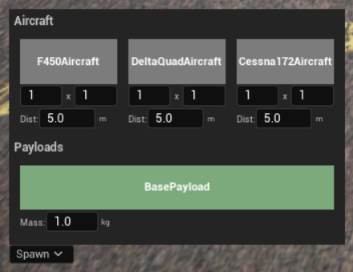

First Steps
===========

1. Open the Spawn panel

After launching PteroSim, find the **Spawn** button in the lower-left corner of the screen.
Clicking it opens the aircraft and payload spawn panel:

2. On the spawn panel, press and hold the cursor on your target aircraft, then drag it into the scene. Spawning is only possible when the simulation is stopped.

3. Press **Start** to start the simulation.

Hotkeys
-------

The same keys can do different things depending on whether you are using the spectator camera, have possessed an aircraft, or are editing a vehicle.

Window and aircraft views
~~~~~~~~~~~~~~~~~~~~~~~~~

.. list-table::
   :header-rows: 1
   :widths: 25 75

   * - Shortcut
     - Action
   * - ``F11`` or ``Alt+Enter``
     - Toggle fullscreen mode.
   * - ``P``
     - Possess the next available aircraft; press again to cycle through aircraft.
   * - ``Esc``
     - Unpossess the aircraft and return to the spectator camera.
   * - ``Tab``
     - Cycle through the possessed aircraft's chase view and camera sensors.
   * - ``V``
     - Toggle VR mode when the VR plugin is available.

Spectator camera
~~~~~~~~~~~~~~~~

These controls apply when no aircraft is possessed.

.. list-table::
   :header-rows: 1
   :widths: 25 75

   * - Shortcut
     - Action
   * - ``W`` / ``S`` or ``Up`` / ``Down``
     - Move the camera forward / backward.
   * - ``A`` / ``D``
     - Move the camera left / right.
   * - ``Space`` or ``E`` / ``Q``
     - Move the camera up / down.
   * - Hold right mouse button and move the mouse
     - Look around.
   * - Left mouse button
     - Select a scene object or drag a gizmo handle; holding it over empty viewport enters camera pan mode.
   * - Mouse wheel up / down
     - Increase / decrease spectator camera movement speed.

Possessed aircraft
~~~~~~~~~~~~~~~~~~

These controls apply after starting the simulation and possessing an aircraft with ``P``. Their effect depends on the aircraft's control source and installed parts.

.. list-table::
   :header-rows: 1
   :widths: 25 75

   * - Shortcut
     - Action
   * - ``W`` / ``S``
     - Pitch forward / backward.
   * - ``A`` / ``D``
     - Roll left / right.
   * - ``Q`` / ``E``
     - Yaw left / right.
   * - ``Space`` / ``Left Ctrl``
     - Raise / lower the throttle lever while held.
   * - ``Enter``
     - Toggle the arm switch.
   * - ``G``
     - Open or close installed grippers, which may pick up or release a payload.

Vehicle editor and scene list
~~~~~~~~~~~~~~~~~~~~~~~~~~~~~

.. list-table::
   :header-rows: 1
   :widths: 25 75

   * - Shortcut
     - Action
   * - ``Ctrl+Z``
     - Undo a vehicle edit.
   * - ``Ctrl+Y`` or ``Ctrl+Shift+Z``
     - Redo a vehicle edit.
   * - ``F2``
     - Rename the selected item in the scene list.
   * - ``Delete`` or ``Backspace``
     - Remove selected scene objects or vehicle parts in the scene list; in the logic graph, remove the selected block.
